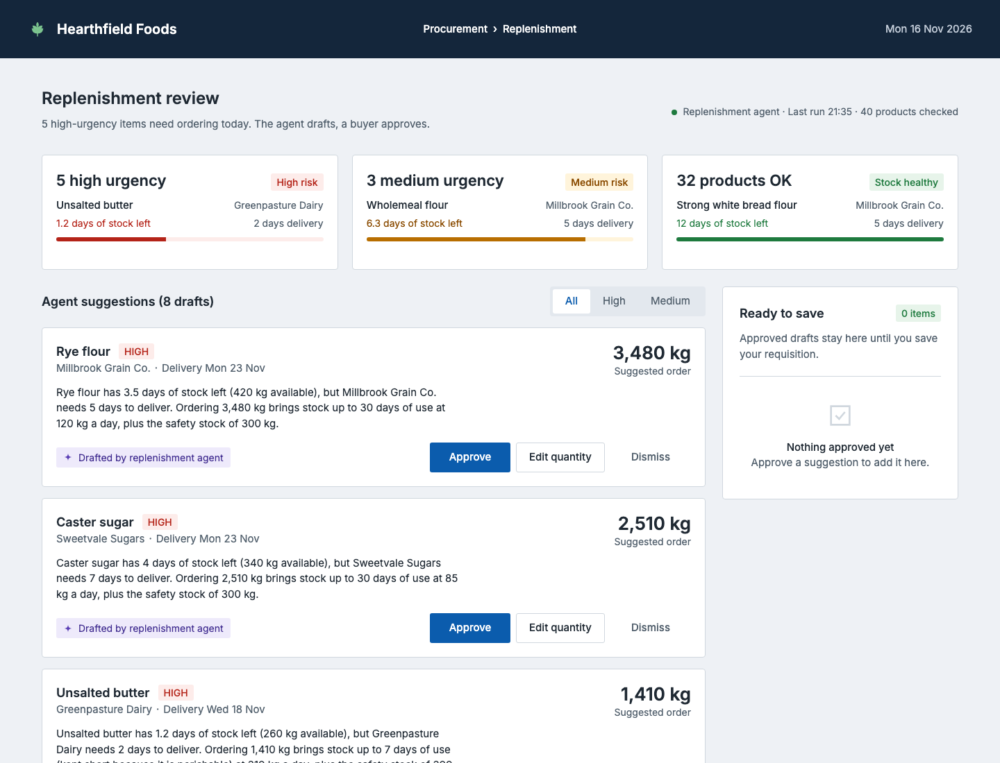

# Replenishment Assistant (Demo)



This is a demo for a fictional food manufacturer, and all data is made up.

Live demo: (link coming soon)

A small demo of an AI agent that helps a **buyer** decide which raw materials
to reorder, and how much.

> **Everything in this project is fictional.** The company, suppliers,
> materials, prices and stock levels are all made up for demonstration
> purposes. No real business data is used.

## The scenario

**Hearthfield Foods** is a fictional mid-size food manufacturer that makes
baked goods and sauces. Its buyer manages dozens of raw materials, such as
flour, sugar, tomato paste, sunflower oil and packaging film.

Every week the buyer has to answer the same questions:

- Which materials are running low?
- Which ones will run out before a new delivery could arrive?
- How much should I order, and from which supplier?

The Replenishment Assistant looks at stock levels, daily usage, supplier lead
times and minimum order quantities, then suggests what to reorder and explains
why in plain language. The buyer stays in charge: the agent only makes
recommendations.

## How it works (planned)

```
  Dashboard (HTML/CSS/JS)  --->  API (FastAPI, Python)  --->  Data (JSON file)
        buyer clicks                works out what to          fictional stock,
        and reads results           reorder and explains why   usage and suppliers
```

1. **Data**: a JSON file holds the fictional materials, stock levels, average
   daily usage and supplier details.
2. **API**: a Python FastAPI app reads the JSON file, calculates how many days
   of stock are left for each material, and flags anything that needs
   reordering.
3. **Agent**: turns those numbers into clear recommendations, for example:
   "Order 2,000 kg of wheat flour from Millbrook Grain. Stock covers 4 days,
   but delivery takes 6."
4. **Dashboard**: a simple web page where the buyer sees the list of
   materials, their status, and the agent's suggestions.

## Tech stack

| Part      | Technology                   | Why                                   |
|-----------|------------------------------|---------------------------------------|
| API       | Python + FastAPI             | Simple, fast, auto-generated API docs |
| Data      | A JSON file                  | No database to set up                 |
| Dashboard | Plain HTML, CSS, JavaScript  | No build tools or frameworks needed   |

## Folder structure

```
replenishment-demo/
├── README.md            # This file: what the project is and how to run it
├── requirements.txt     # Python packages the project needs
├── pytest.ini           # Settings for the tests
├── backend/
│   ├── main.py          # The FastAPI app (the API endpoints)
│   ├── agent.py         # Drafts reorder suggestions with a reason for each
│   └── check_data.py    # Validates data.json and holds the risk rules
├── data/
│   ├── data.json        # Fictional products and suppliers
│   └── requisitions.json  # Created automatically when you save a requisition
├── tests/               # Automated tests (run with pytest)
├── scripts/
│   └── export_demo_data.py  # Saves a data snapshot for the static demo
└── frontend/            # The HTML/CSS/JavaScript dashboard
    ├── index.html
    ├── styles.css
    ├── app.js
    └── demo-data.json   # Snapshot used in demo mode (no API needed)
```

## Setup (once)

You need Python 3.10 or newer. In a terminal, from the project folder:

```bash
python3 -m venv .venv              # create a private folder for packages
source .venv/bin/activate          # switch to it (Windows: .venv\Scripts\activate)
pip install -r requirements.txt    # install FastAPI, uvicorn, pytest, httpx
```

Each time you open a new terminal, run `source .venv/bin/activate` again.
You will see `(.venv)` at the start of the prompt when it is active.

## How to run it

The addresses below only work after you start the project on your own
computer.

1. Create and activate the virtual environment, then install the packages
   (see [Setup](#setup-once) for details):

   ```bash
   python3 -m venv .venv
   source .venv/bin/activate
   pip install -r requirements.txt
   ```

2. Start the API (stop it with Ctrl+C):

   ```bash
   .venv/bin/uvicorn backend.main:app --reload
   ```

3. In a second terminal, start the dashboard page:

   ```bash
   python3 -m http.server 5500 -d frontend
   ```

4. Open `http://localhost:5500` in your browser.

While the API is running, its interactive docs are at
`http://127.0.0.1:8000/docs`, where you can try every endpoint.

### Other commands

```bash
python3 backend/check_data.py             # check the data and count products per risk group
pytest                                    # run the tests
.venv/bin/python scripts/export_demo_data.py  # refresh frontend/demo-data.json
```

### Demo mode

When the dashboard is opened from `localhost` or `127.0.0.1`, it uses the API.
On any other address (for example a static hosting site), it loads
`frontend/demo-data.json` instead and shows a "Demo mode" banner. Approve,
Edit quantity and Dismiss work as usual, but saving never calls the API.
Run `scripts/export_demo_data.py` to refresh the snapshot.

| Endpoint             | What it does                                                   |
|----------------------|----------------------------------------------------------------|
| `GET /stock`         | All products, with `days_of_stock_left` and `risk_group` added |
| `GET /suppliers`     | All suppliers                                                  |
| `GET /agent/suggestions` | Draft requisitions for at-risk products, with quantity, urgency, delivery date and a reason. Saves nothing |
| `POST /requisitions` | Saves `{"product_id": "P003", "quantity": 2000}` to `data/requisitions.json` and returns the saved record |

## How the agent decides

For every product in the **will run out** or **close to limit** group,
`backend/agent.py` drafts a requisition:

```
quantity = (coverage days × daily usage) + safety stock − (current stock + on order)
           rounded up, and never below the product's min_order_quantity
```

- **Coverage days** is 30, or 7 for products marked `"perishable": true`
  (milk, cream, cream cheese, butter, fresh yeast), so they don't spoil.
- **Minimum order quantity** is set per product (`min_order_quantity`), for
  example 5,000 kg for bread flour but 50 kg for shrink-wrap film.
- **Expected delivery** is today plus the supplier's lead time, moved to Monday
  if it lands on a weekend.
- **The reason** is two sentences built from templates with the real numbers.
  The templates use "has" or "have" depending on the product name, and count
  items by their own name ("9,600 boxes" rather than "9,600 units").

All of these numbers are named constants at the top of `backend/agent.py`.
The agent only suggests: nothing is saved until someone sends a draft to
`POST /requisitions`.

## Planned steps

- [x] Project description and folder structure
- [x] Fictional data in `data/`
- [x] FastAPI app in `backend/` that serves the data
- [x] Reorder logic (suggested order quantity)
- [x] Agent that explains its recommendations in plain language (template-based)
- [x] Dashboard in `frontend/`
- [x] Demo mode with a data snapshot, so the dashboard can run as a static site
